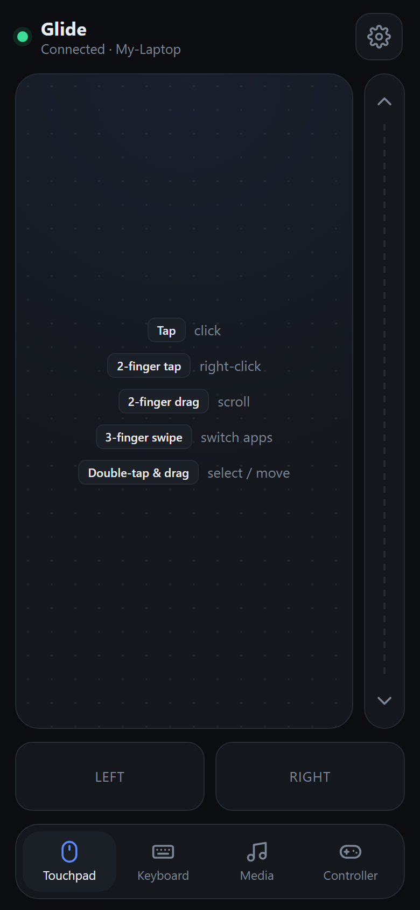
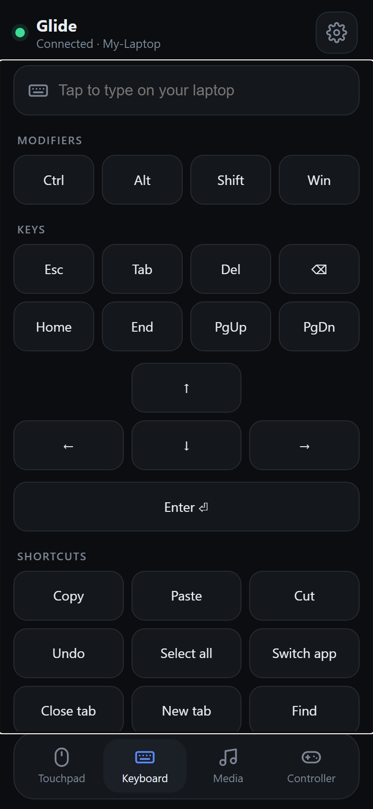
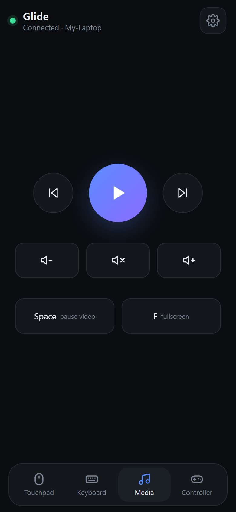
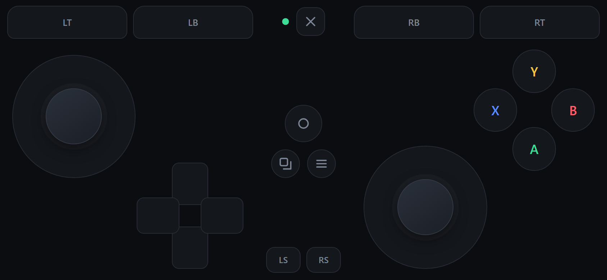

# Glide

Use your phone as a touchpad and keyboard for your laptop over WiFi. Nothing to install on the phone.

<p>
  
  
  
</p>
<p></p>

## Setup (Windows)

1. Download **[Glide.exe](https://github.com/Adarsh0603/Glide/releases/latest/download/Glide.exe)** and move it to a folder where it can stay.
2. Double-click it and follow the steps it shows. Glide starts automatically at every login after that.
3. Open the link it shows on your phone, then add the page to your home screen.

Windows may warn about the download because the app isn't signed. Click **More info > Run anyway**.

## Gestures

| Gesture | Action |
|---|---|
| 1-finger drag | Move cursor |
| Tap | Left click |
| 2-finger tap | Right click |
| 2-finger drag | Scroll |
| Double-tap and drag | Drag / select |
| 3-finger swipe left/right | Switch apps |
| 3-finger swipe up / down | Task View / Show desktop |

The **Keyboard** and **Media** tabs have typing, shortcuts and media keys.

## Controller

The **Controller** tab turns your phone into an Xbox controller that games on the laptop see as a real one. Turn the phone sideways.

On Windows it uses the free [ViGEmBus](https://github.com/nefarius/ViGEmBus) driver, which comes with Glide. Setup offers to install it, or tap **Install on laptop** on the Controller screen and approve the Windows prompt. macOS isn't supported.

## Troubleshooting

- **Phone can't connect:** double-click Glide.exe again. It checks your WiFi and firewall and offers to fix them.
- **"Not secure" warning:** this is normal. Glide uses its own certificate, and the connection is still encrypted. To remove the warning, open Settings (gear icon) in Glide on your phone, tap **Remove "not secure" warning**, and install the certificate it downloads.
- **New link:** run `Glide.exe --reset`. The old link and all paired phones stop working.
- **Uninstall:** run `Glide.exe --uninstall`.

## From source (any OS)

```
pip install pynput cryptography vgamepad
python glide.py --install
```

To build the exe yourself, run `powershell -ExecutionPolicy Bypass -File build.ps1`. On macOS, allow Python under Privacy & Security > Accessibility.
